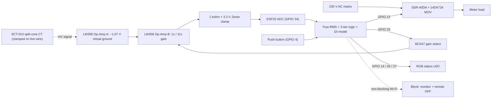

# TripCore

**Edge-first, self-calibrating 3-tier motor protection relay with non-blocking IoT monitoring.**


-00979D)


> **Status: bench prototype.** Verified on a table fan and a brushed universal motor using current injection. **Not tested on a real pump. Not certified.** Do not use as the only protection for any motor.

---

## Table of contents

1. [Problem](#1-problem)
2. [System architecture](#2-system-architecture)
3. [Analog front-end and auto-gain](#3-analog-front-end-and-auto-gain)
4. [Protection logic](#4-protection-logic)
5. [Hardware](#5-hardware)
6. [Bench verification](#6-bench-verification)
7. [Blynk IoT setup](#7-blynk-iot-setup)
8. [Quick start](#8-quick-start)
9. [Scaling to larger motors](#9-scaling-to-larger-motors)
10. [Known limitations and V2 roadmap](#10-known-limitations-and-v2-roadmap)
11. [Repository layout](#11-repository-layout)

---

## 1. Problem

Small agricultural pumps and workshop motors burn out from three physical faults:

| Fault | What happens | Why a fuse or MCB misses it |
|---|---|---|
| **Dry run** | Pump spins in air, load disappears, current **drops** | Current is below the breaker rating |
| **Sustained overload** | Worn bearing or clogged impeller, current **rises moderately** and the winding heats | A breaker sized above the motor's running current can sit under its rating for a long time |
| **Locked rotor** | Shaft stops, current **spikes** | Only large faults reach the breaker's trip level |

Fixed thresholds also fail in both directions: set low, they trip on the 3x to 6x startup inrush; set high, they miss slow overheating. A 0.3 A motor gives a signal near ADC noise, while a large motor clips a fixed high gain.

### Why panel-side current sensing

Casing-mounted sensors (vibration or temperature) are impractical for submersible pumps that sit deep in a borewell, and heat reaches a casing sensor with a delay. TripCore measures **motor current at the panel** with one non-invasive split-core CT. It needs no access to the motor, and the trip decision is made locally, with no internet.

TripCore **estimates** winding heating with an I²t model. It does not measure winding temperature, and the model constants are bench-tuned (see [Limitations](#10-known-limitations-and-v2-roadmap)).

---

## 2. System architecture



**Design rule:** protection runs entirely on the ESP32. Wi-Fi and Blynk are a secondary monitoring layer. Reconnect attempts pause while a fault is developing, so networking never stalls a trip.

---

## 3. Analog front-end and auto-gain

### 3.1 Sensor

The SCT-013-030 is a 30 A : 1 V split-core CT with a built-in burden, so there is **no external burden resistor**.

$$\text{Sensitivity} \approx \frac{1\ \text{V}}{30\ \text{A}} = 33.3\ \text{mV per A·turn}$$

Passing the wire through the CT window $N$ times multiplies the signal by $N$.

### 3.2 Stage 1: virtual ground (Op-Amp A, pins 1-2-3)

Two 10 kΩ resistors divide 3.3 V to about 1.65 V. Op-Amp A buffers it into a low-impedance **~1.67 V virtual ground**, so the bipolar AC wave sits inside the ESP32's 0 to 3.3 V ADC range.

### 3.3 Stage 2: two-gear gain (Op-Amp B, pins 5-6-7 + BC547)

A non-inverting amplifier with $R_f = 100\ \text{k}\Omega$ and $R_g = 10\ \text{k}\Omega$. The BC547 (driven from GPIO 25 through 4.7 kΩ) connects or disconnects $R_g$ to ground.

$$A_v = 1 + \frac{R_f}{R_g}$$

| GPIO 25 | BC547 | $R_g$ | Gain | Use |
|---|---|---|---|---|
| LOW | OFF | open | $A_v = 1$ (1x) | Large loads, startup surges (prevents clipping) |
| HIGH | ON | 10 kΩ | $A_v = 1 + 100/10 = 11$ (11x) | Small loads (lifts signal above the noise floor) |

This is a **two-gear switch**, not a continuously variable gain, like the mA and A ranges of a multimeter.

### 3.4 AC-coupled gain network

The 10 µF capacitor in series with the 10 kΩ resistor forms a high-pass corner:

$$f_c = \frac{1}{2\pi R C} = \frac{1}{2\pi \cdot 10\,\text{k}\Omega \cdot 10\,\mu\text{F}} \approx 1.59\ \text{Hz}$$

DC gain stays at 1x, so the virtual ground does not drift when the gear changes. 50 Hz AC receives the full gain. **Measured:** the DC midpoint stays near 1670 mV in both gears.

> After the BC547 switches, the capacitor needs a few hundred milliseconds to settle (time constant about 100 ms). Do not sample for decisions during that interval.

### 3.5 Protection

- **1 kΩ series resistor + 3.3 V Zener** on GPIO 34 protects the ESP32 pin from the 5 V op-amp rail.
- **14D471K MOV** across the SSR AC terminals absorbs the inductive spike when the motor is switched off.
- GPIO 34 is **ADC1** (ADC1_CH6), so Wi-Fi activity does not block ADC sampling.

### 3.6 Auto-ranging rules

| Rule | Value |
|---|---|
| Start in | 1x |
| During LEARN, if 1x RMS is below | **65.0 mV** then switch to 11x and save |
| If live RMS in 11x exceeds | **780 mV** then downshift to 1x |
| Wake (motor-running) threshold | 16.5 mV at 1x, 35.0 mV at 11x |

---

## 4. Protection logic

### 4.1 Signal processing

- 200 samples at 2 kHz = 100 ms = exactly 5 full 50 Hz cycles.
- The DC midpoint is recomputed and subtracted in every window.
- True-RMS and crest factor (peak / RMS) are computed per window:

$$I_{rms} = \sqrt{\frac{1}{N}\sum_{k=1}^{N}\left(x_k - \bar{x}\right)^2}, \quad N = 200$$

### 4.2 LEARN calibration

Hold the button for **2.5 s** on a healthy, running motor. The firmware picks the gear, measures the healthy RMS (`I_base`), and stores `I_base` and the gain in ESP32 NVS Flash (`Preferences`, namespace `"tripcore"`). It survives power cuts. Every fault rule is a **percentage of `I_base`**, so the same logic runs on different motors.

### 4.3 Startup mask

6.0 s inrush bypass after motor current is detected, so the normal 3x to 6x starting current does not trip.

### 4.4 The three tiers

Let $r = I_{rms} / I_{base}$.

| Tier | Fault | Condition | Action | LED |
|---|---|---|---|---|
| 1 | **Locked-rotor jam** | $r \ge 1.75$ for **0.25 s** | Immediate cutoff | Solid **RED** |
| 2 | **Thermal overload (I²t)** | $1.25 \le r < 1.75$, heat $H \ge 3.5$ | Cutoff | Solid **YELLOW** |
| 3 | **Dry run / under-load** | $r < 0.72$ for **2.5 s** | Cutoff | Solid **BLUE** |

**I²t thermal bucket:**

$$H \leftarrow H + (r^2 - 1)\,\Delta t \quad (\text{overload band}), \qquad H \leftarrow H - 0.5\,\Delta t \quad (\text{normal load, floor } 0)$$

Brief load bumps drain away. Sustained drag accumulates heat until $H \ge 3.5$.

Computed from the model (not measured):

| $r$ | Heat rate $(r^2-1)$ per s | Time to $H = 3.5$ |
|---|---|---|
| 1.25 | 0.56 | about 6.2 s |
| 1.50 | 1.25 | about 2.8 s |
| 1.75 | 2.06 | about 1.7 s (Tier 1 usually fires first) |

> The only fast path is Tier 1 (0.25 s). Dry run takes 2.5 s and overload takes seconds by design. TripCore does **not** isolate every fault in 250 ms.

### 4.5 LED status table (common anode, active LOW)

| Colour | State |
|---|---|
| Solid **GREEN** | Normal, protected |
| **CYAN** | Learning baseline |
| Solid **RED** | Tier 1: locked rotor |
| Solid **YELLOW** | Tier 2: thermal overload |
| Solid **BLUE** | Tier 3: dry run |
| **PURPLE** | Remote OFF via Blynk |

---

## 5. Hardware

### 5.1 Pinout

| GPIO | Function |
|---|---|
| 34 | Analog current input (LM358 pin 7, through 1 kΩ + 3.3 V Zener) |
| 25 | Gain select: LOW = 1x, HIGH = 11x (through 4.7 kΩ to BC547 base) |
| 13 | SSR-40DA control: HIGH = armed/ON, LOW = cut 230 V AC (with 10 kΩ pull-down) |
| 4 | Push button to GND (INPUT_PULLUP): short press = reset trip, 2.5 s hold = LEARN |
| 14 / 26 / 27 | Common-anode RGB LED: Red / Green / Blue (active LOW, 330 Ω each, common to 3.3 V) |
| 35 | Reserved for the analog diagnostic probe (`TripCore_Probe`) |

### 5.2 Approximate prototype BOM

Prices are **author estimates for Indian retail**. Replace them with your own receipts.

| Part | Qty | Approx. ₹ |
|---|---|---|
| ESP32 DevKit | 1 | 400 to 500 |
| SCT-013-030 (30 A : 1 V) | 1 | 300 to 400 |
| SSR-40DA (with heatsink for load) | 1 | 200 to 300 |
| LM358, BC547, 3.3 V Zener, 14D471K MOV, resistors, capacitors | set | 50 to 90 |
| Common-anode RGB LED, push button | 1 each | 20 to 30 |
| Breadboard, jumpers | set | 60 to 100 |
| **Total** | | **about ₹1,000 to ₹1,500** |

Resistors and capacitors used: 2 × 10 kΩ (divider), 100 kΩ (feedback), 10 kΩ + 10 µF (gain branch), 4.7 kΩ (BC547 base), 1 kΩ (ADC series), 10 kΩ (GPIO 13 pull-down), 3 × 330 Ω (LED).

> **Market context:** simple dry-run protectors already sell in India for a few hundred to a few thousand rupees. TripCore's difference is **self-calibration with hardware auto-ranging and an I²t model**, not price.

---

## 6. Bench verification

### 6.1 Why ampere-turn injection

A domestic 55 W PSC table fan is impedance-protected. Its locked-rotor current rises only about 10 to 25 %, so it can never reach the 175 % jam level. Braking it by hand is also unsafe. Instead, the number of wire passes through the CT window is changed, which scales the CT signal to the target current levels:

| Wire passes | Signal vs baseline | Expected result |
|---|---|---|
| 2 | 100 % (baseline, LEARN here) | GREEN |
| 1 | 50 % | Tier 3 dry run, BLUE after 2.5 s |
| 0 | 0 % | Tier 3 dry run |
| 3 | 150 % | Heat climbs to 3.5, Tier 2 YELLOW in about 2.8 s |
| 4 | 200 % | Tier 1 jam, RED after 0.25 s |

**What this proves:** the sensing chain, the thresholds, the timers, and the SSR cutoff. **What it does not prove:** how a real motor behaves when it jams, drags, or runs dry. A real-pump test is future work.

> **Safety:** disconnect mains before changing the number of passes. The motor-side wire can be live, and an SSR can leak or fail ON.

### 6.2 Measured results

| Measurement | Result |
|---|---|
| DC midpoint, 1x and 11x | steady at about 1670 mV |
| Gain ratio, 18.89 mV at 1x → 182.63 mV at 11x | 9.67x |
| Gain ratio, 13.4 mV at 1x → 115.7 mV at 11x | 8.63x |
| Theoretical ratio | 11x |

The measured ratio is **below 11x**. Candidate causes are resistor tolerance, BC547 on-resistance, and noise inflating the small 1x reading, but none is confirmed. Treat 11x as nominal, and calibrate against a clamp meter before relying on absolute values. Percentage rules are less sensitive because `I_base` is learned in the same gear.

### 6.3 Diagnostic suite

| Tool | Purpose |
|---|---|
| `TripCore_Doctor` | Automated 5-step hardware and Flash audit |
| `TripCore_Probe` | Live analog fault locator on GPIO 35 (one-wire probe) |

### 6.4 Images

| | |
|---|---|
|  |  |
| Breadboard, CT, SSR and fan | Blynk SuperChart, LED and switch |


---

## 7. Blynk IoT setup

Blynk is **optional monitoring and remote OFF only**. Local protection never depends on it.

### 7.1 Non-blocking design

- Uses `WiFi.begin()` and `Blynk.config()` with non-blocking reconnects (never the blocking `Blynk.begin()`).
- Reconnect attempts pause while a fault is developing.
- The firmware keeps protecting with Wi-Fi off.

### 7.2 Datastreams

| Pin | Purpose |
|---|---|
| `V0` | Motor ON/OFF and reset switch |
| `V1` | Live load % (SuperChart, 1 Hz) |
| `V2` | RMS in mV |
| `V3` | I²t thermal heat (0 to 4) |
| `V4` | Status / fault string |
| `V5` | Status LED widget (colour synced to state) |
| `V6` | Crest factor |

**Event:** create an event named `motor_fault` in the Blynk template to receive push notifications.

### 7.3 Intentional safety constraint: no online LEARN

Remote **OFF is fail-safe**. Remote **LEARN is fail-dangerous**: calibrating a dry or jammed motor would overwrite Flash with a fault baseline and make the fault look normal. Like commercial switchgear, calibration requires **physical presence** (2.5 s button hold).

### 7.4 Credentials security

- Keep Wi-Fi and Blynk credentials in a local `secrets.h`. It is listed in `.gitignore`.
- **Never commit tokens.** If a token was ever pushed, **rotate it in the Blynk console**. Deleting the file does not remove it from Git history.

---

## 8. Quick start

> **Mains warning:** the 230 V side can kill. Work with the plug pulled, use a fuse or MCB upstream (not part of this BOM), and ask an experienced person to check your wiring before the first power-up.

1. **Install** the Arduino IDE (or Arduino CLI), the **ESP32 board package**, and the **Blynk** library.
2. **Wire** the breadboard using the [pinout](#51-pinout). Check the 3.3 V, 5 V and 1.65 V nodes with a multimeter on USB power only.
3. **Flash `diagnostics/TripCore_Doctor/TripCore_Doctor.ino`** first and read the Serial output. Fix any failed step before continuing.
4. *(Optional)* Flash `TripCore_Probe` to locate analog faults using GPIO 35.
5. **Choose firmware:**
   - `firmware/TripCore_SAFE/TripCore_SAFE.ino` for standalone offline protection.
   - `firmware/TripCore_Blynk/TripCore_Blynk.ino` for protection plus Blynk. Create `secrets.h` next to it with your Wi-Fi and Blynk credentials (see the top of the sketch for the exact names it expects).
6. **LEARN:** run the healthy motor, wait out the startup mask, then hold the button 2.5 s. The LED turns CYAN, then GREEN.
7. **Test** with the [injection table](#61-why-ampere-turn-injection).

---

## 9. Scaling to larger motors

**Design guidance, not validated beyond the bench.**

The learn step, the percentage rules and the two-gear stage are independent of motor size. What changes per range is the **CT and the switching device**:

| Motor range (approx.) | CT (1 V output) | Switching |
|---|---|---|
| Up to about 1 HP | 10 to 20 A | SSR with heatsink or relay |
| About 1 to 2 HP | 30 A | Relay or contactor |
| About 2 to 3 HP | 50 A | Contactor with coil driver |

Rule of thumb: **CT rating about 2 to 3 times the motor's full-load current**, so a 175 % jam still fits the reading range.

### 9.1 Contactor-coil switching

For larger motors, motor current should **not** pass through the SSR. Instead, the SSR switches the **coil circuit** of the existing DOL or star-delta contactor, so the TripCore controller stays the same while the contactor carries the motor current.

Honest limits:

- **Controller cost stays roughly flat. Total cost does not.** The CT and contactor scale with motor size.
- Larger motors are usually **3-phase**. One CT watches one phase only, so single-phasing and unbalance are **not detected** until the 3-phase V2.
- The SSR can **fail ON**, which would leave the contactor energised. A mechanical relay or an independent hardware cutoff is recommended.
- Check the SSR's minimum load and leakage against the coil you switch.
- Contactor wiring and sizing must be done by a qualified electrician.

---

## 10. Known limitations and V2 roadmap

### Current limitations

- **Simulated faults only:** verified with current injection, not on a real pump.
- Constants (72 %, 2.5 s, 3.5, 0.5 per s, 6 s mask) are **bench-tuned**. A real winding cools over minutes and tolerates overload differently.
- **Current-only, single-phase.** No voltage or power-factor measurement, so a grid sag cannot be told apart from a real fault.
- Measured gain ratio is below nominal 11x (see 6.2).
- No gear change mid-run should be assumed accurate until `I_base` rescaling on downshift is verified with a clamp meter.
- Remote ON/reset through Blynk can start a machine without anyone present. Use the local button for restart in real installations.
- No fuse or MCB is included in the BOM. Add one upstream.
- Not certified to any protection standard.

### V2 roadmap

| Item | Purpose |
|---|---|
| Passive RC anti-aliasing filter (custom PCB) | Cleaner ADC input |
| Custom 2-layer PCB with high-voltage creepage and clearance | Safe mains layout |
| ZMPT101B voltage sensing and true power factor | Separate rural brownouts and switch-off from true dry run |
| 3-phase support: single-phasing, unbalance, earth fault | Three-phase motors |
| Higher-rate DMA sampling with FFT / MCSA | Early bearing-wear detection |
| External hardware watchdog and mechanical relay | Fail-safe cutoff |

---

## 11. Repository layout

```text
TripCore-Motor-Protection-Relay/
├── README.md
├── .gitignore
├── LICENSE
├── firmware/
│   ├── TripCore_Blynk/TripCore_Blynk.ino    # Edge protection + Blynk monitoring
│   └── TripCore_SAFE/TripCore_SAFE.ino      # Standalone offline protection
├── diagnostics/
│   ├── TripCore_Doctor/TripCore_Doctor.ino  # 5-step hardware + Flash audit
│   └── TripCore_Probe/TripCore_Probe.ino    # GPIO 35 analog fault locator
└── docs/images/
    ├── hardware_setup.jpg
    ├── blynk_dashboard.png
    └── serial_verification.png
```

## License

MIT. See [LICENSE](LICENSE).

